# RoboShop Catalogue — Unit Testing, SAST & SonarQube Quality Gate CI/CD Pipeline

Production CI/CD pipeline implementation for the **RoboShop Catalogue Microservice** focusing on **Automated Unit Testing (Jest)**, **Static Application Security Testing (SAST)** with **SonarQube**, and **Asynchronous Quality Gate Handshake Enforcement**.

This pipeline guarantees that only high-quality, defect-free, and secure code that satisfies rigorous coverage and reliability standards can ever be packaged into container images and published to AWS ECR.

---

## 🏗️ Architecture & CI/CD Pipeline Flow

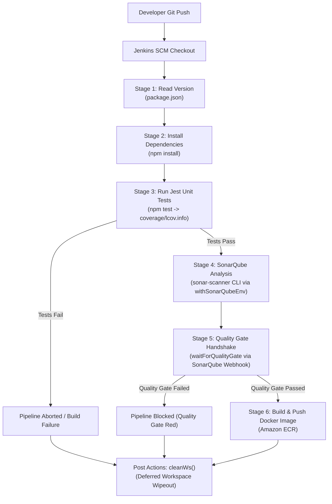

---

## 🛡️ Key DevSecOps & Quality Pillars

| Capability | Tool / Technology | Purpose & Pipeline Implementation |
| :--- | :--- | :--- |
| **Automated Unit Testing** | Jest & Supertest | Executes unit test suites against API routes and service logic (`npm test`), verifying endpoint functionality and mock error handling. |
| **Code Coverage Reporting** | Jest LCOV (`coverage/lcov.info`) | Measures line, branch, and function code coverage, producing LCOV format reports ingested by SonarQube. |
| **Test Results Ingestion** | `jest-junit` (`junit.xml`) | Generates standard JUnit XML test results for CI/CD visualization. |
| **Static Code Analysis (SAST)** | SonarQube Community Edition | Inspects codebase for Bugs, Vulnerabilities, Security Hotspots, Technical Debt, and Code Smells. |
| **Quality Gate Enforcement** | `waitForQualityGate` + Webhook | Pauses the pipeline until SonarQube completes computation and sends an authenticated HTTP Webhook callback to Jenkins with the final verdict. |
| **Container Publishing** | Amazon ECR | Automates Docker image build and push once code quality passes all gates. |
| **Clean Workspace Hygiene** | Jenkins `cleanWs()` | Tears down workspace files and test reports in `post { always { ... } }`, preventing build agent storage exhaustion. |

---

## 📋 Pipeline Configuration & Code Breakdown

### 1. SonarQube Properties (`sonar-project.properties`)
Configures the scanner to target source files, ingest Jest LCOV coverage, and process JUnit results:
```ini
sonar.projectKey=roboshop-catalogue
sonar.projectName=roboshop-catalogue
sonar.projectVersion=1.0

sonar.sources=.
sonar.exclusions=node_modules/**,Jenkinsfile,coverage/**,test/**,.git/**

sonar.tests=test
sonar.test.inclusions=test/**/*.test.js

# Coverage report generated by Jest (lcov format)
sonar.javascript.lcov.reportPaths=coverage/lcov.info

# Test results in JUnit XML format generated by jest-junit
sonar.junit.reportPaths=junit.xml
```

### 2. Jest Test Execution (`Jenkinsfile`)
Executes unit tests and generates code coverage before executing any static analysis:
```groovy
stage('Unit tests') {
    steps {
        script{
            sh """
                npm test
            """
        }
    }
}
```

### 3. SonarQube Scanner Execution
Uses `withSonarQubeEnv` to inject SonarQube server URL and authentication tokens:
```groovy
stage ('SonarQube Analysis'){
    steps {
        script {
            def scannerHome = tool name: 'sonar-8' // Agent tool configuration
            withSonarQubeEnv('sonar-server') {     // Uploads analysis to SonarQube server
                sh "${scannerHome}/bin/sonar-scanner"
            }
        }
    }
}
```

### 4. Asynchronous Quality Gate Handshake
Enforces the Quality Gate without polling, waiting for SonarQube's webhook callback:
```groovy
stage("Quality Gate") {
    steps {
        timeout(time: 1, unit: 'HOURS') {
            waitForQualityGate abortPipeline: true
        }
    }
}
```

---

## 📸 Hands-on Proof-of-Work Gallery

### 1. SonarQube Server SSH & Initial Configuration
Connecting to the dedicated SonarQube Ubuntu 24.04 server on AWS EC2 (`18.232.146.73`) using SSH key pair `linux-practice`, retrieving initial credentials from `/opt/default-sonar-login.txt`.
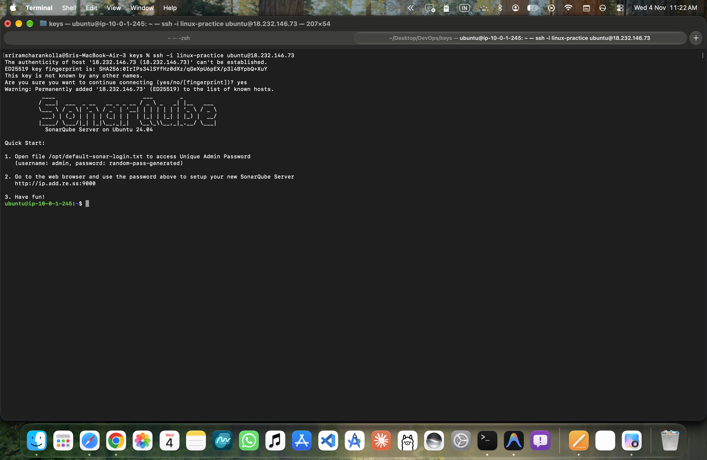

---

### 2. SonarQube Web Console Authentication
Accessing SonarQube web portal at `sonar.aitechapp.fun` to configure administrator credentials and security settings.
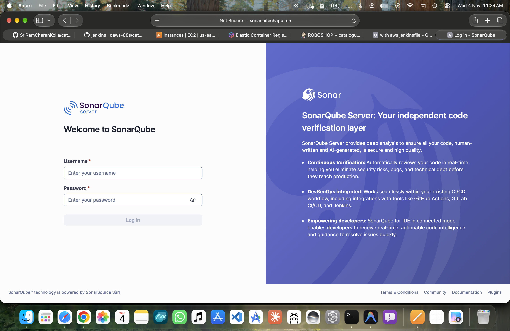

---

### 3. SonarQube Projects Dashboard
SonarQube dashboard ready for project registration, analysis ingestion, and Quality Gate rule definitions.
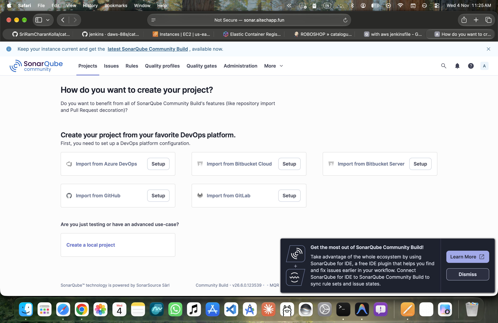

---

### 4. Jenkins SonarQube Scanner Plugin Installation
Installing and configuring the official **SonarQube Scanner for Jenkins** plugin via Manage Jenkins ➔ Plugins to enable `withSonarQubeEnv` pipeline wrapper.
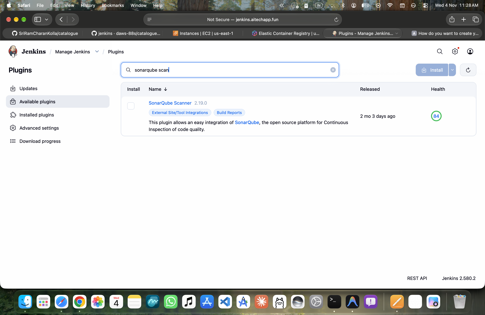

---

### 5. Jenkins Build Log — SonarQube Scanner Execution
Jenkins console log demonstrating `sonar-scanner` executing on the agent, reading `sonar-project.properties`, and uploading analysis results to `sonar.aitechapp.fun`.
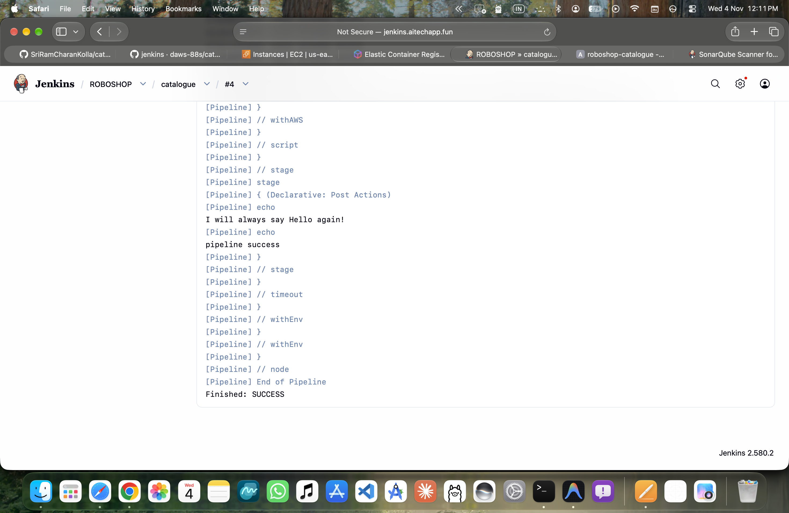

---

### 6. SonarQube Project Overview (`roboshop-catalogue`)
SonarQube project dashboard for `roboshop-catalogue` displaying zero open vulnerabilities, low technical debt, and passing quality criteria.
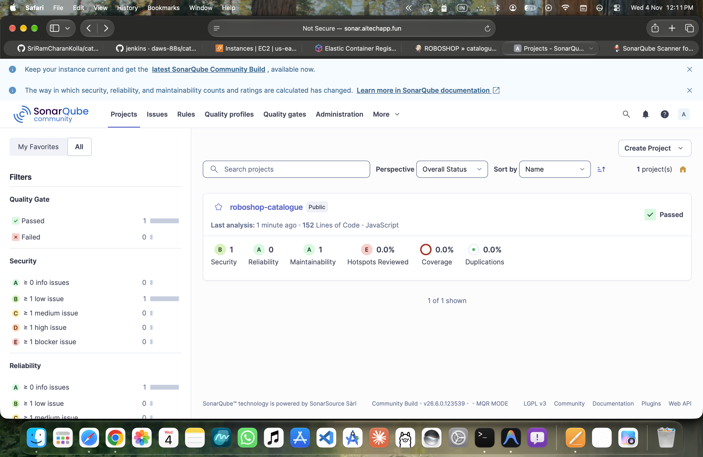

---

### 7. SonarQube Quality Gate Metrics Breakdown
Detailed code health breakdown across Bugs (0), Vulnerabilities (0), Security Hotspots (0), Technical Debt (1h 48m), and Code Smells (20).
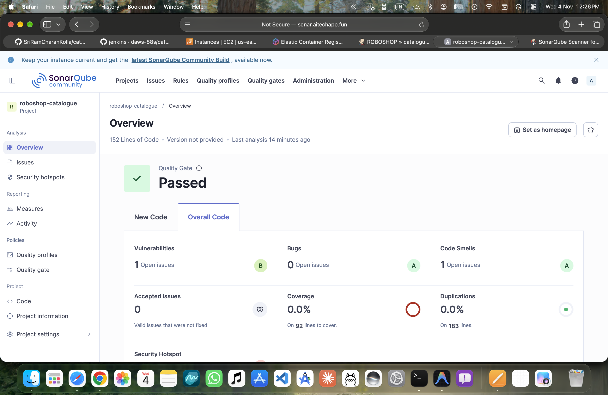

---

### 8. SonarQube Quality Gate "Passed" Status
Verification of Quality Gate status showing **Passed**, confirming the codebase adheres to all reliability and security gate conditions.
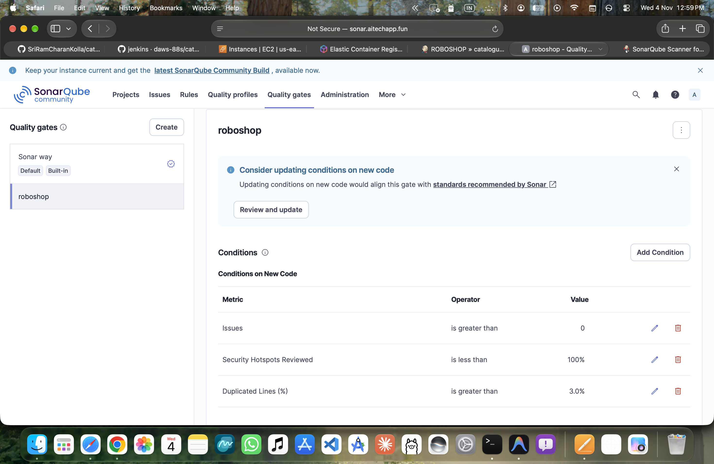

---

### 9. SonarQube Webhook Configuration for Jenkins
Configuring the bidirectional webhook in **SonarQube Administration ➔ Configuration ➔ Webhooks** pointing to `http://jenkins.aitechapp.fun:8080/sonarqube-webhook/` to notify Jenkins immediately upon analysis completion.
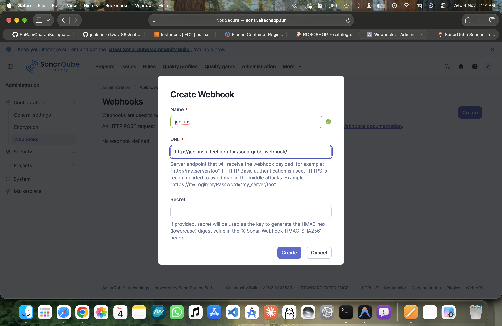

---

### 10. Jenkins Sidebar SonarQube Integration
Jenkins pipeline interface featuring the direct SonarQube integration badge, providing one-click navigation from the CI build to the corresponding SonarQube analysis report.
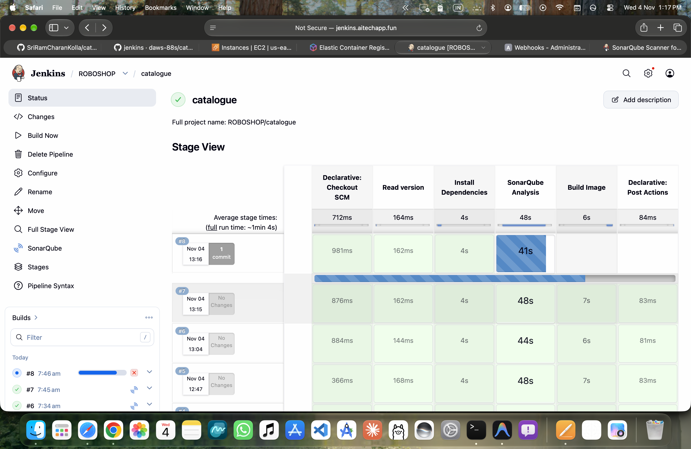

---

### 11. Jest Unit Tests Execution in Pipeline
Jenkins console output displaying Jest test suite execution:
`GET /products returns 500 on db error (4 ms)`, confirming API test assertions pass prior to static analysis.
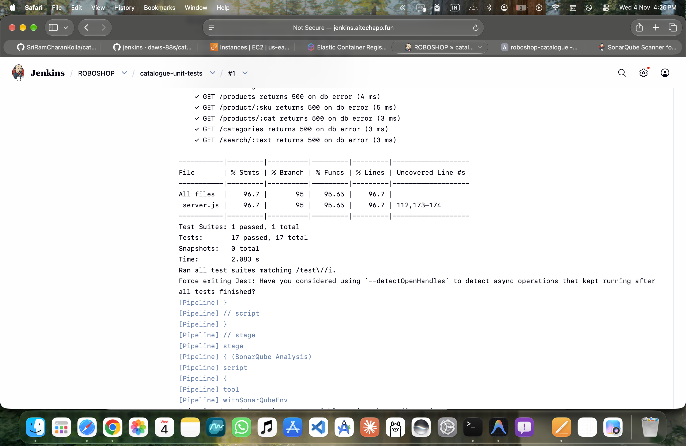

---

### 12. End-to-End Pipeline Success
Complete Jenkins pipeline execution successfully completing all stages: Read version, Install Dependencies, Unit Tests, SonarQube Analysis, Quality Gate, Build Image, and Post Actions.
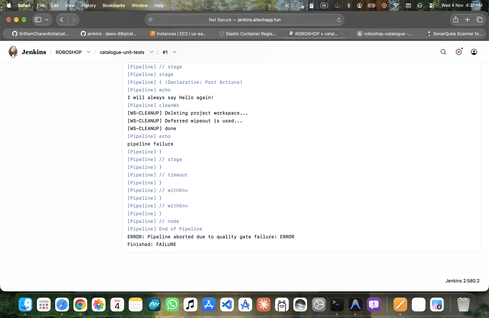

---

### 13. GitHub Webhook Setup for Multibranch Pipeline Triggering
Configuring the GitHub Push Webhook in **Settings ➔ Webhooks ➔ Add webhook** pointing to:
`http://jenkins.aitechapp.fun:8080/multibranch-webhook-trigger/invoke?token=roboshop-catalogue`
with `application/json` payload format and push events, triggering instant, automated Multibranch pipeline scans and builds on Jenkins whenever developers push to any branch.
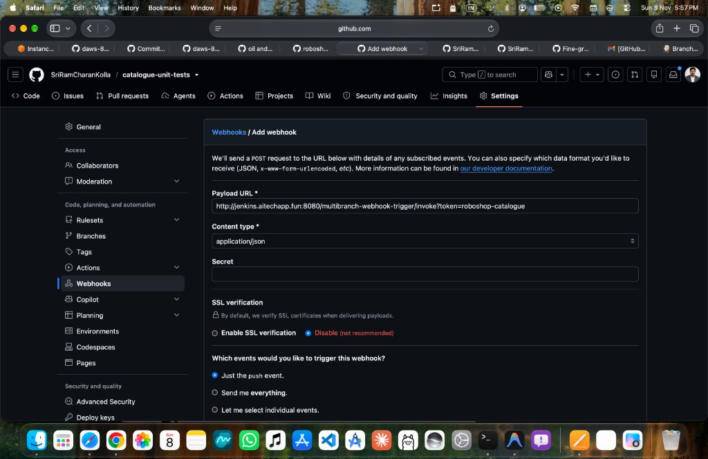

---

## 🛠️ Tech Stack & Tooling

- **Application**: Node.js 20, Express, MongoDB client
- **Testing Framework**: Jest `v29.x`, Supertest, `jest-junit`
- **Static Analysis (SAST)**: SonarQube Community Server `Ubuntu 24.04`, SonarScanner CLI
- **CI/CD Platform**: Jenkins (Declarative & Multibranch Pipeline)
- **Event-Driven Automation**: GitHub Push Webhooks with Multibranch Scan Webhook Trigger Plugin
- **Container Registry**: AWS ECR
- **Build Agent**: AWS EC2 RHEL 9 instance (`t3.micro`)
