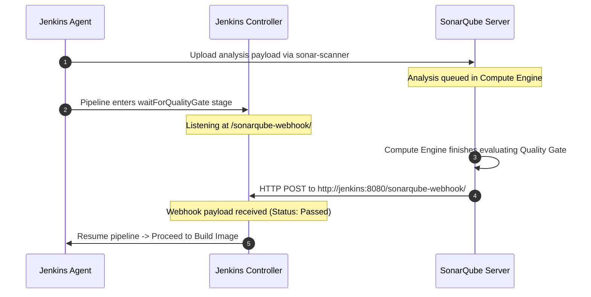

# SonarQube, Jest Unit Testing & Quality Gate Learnings (`learning.md`)

This document captures architecture patterns, debugging methodologies, and key technical takeaways from implementing the **RoboShop Catalogue Unit Testing & SonarQube Quality Gate pipeline**.

---

## 📑 Table of Contents
1. [The Bidirectional Webhook Handshake Architecture](#1-the-bidirectional-webhook-handshake-architecture)
2. [Why `waitForQualityGate` Requires a SonarQube Webhook](#2-why-waitforqualitygate-requires-a-sonarqube-webhook)
3. [Jest Coverage Ingestion into SonarQube (`lcov.info`)](#3-jest-coverage-ingestion-into-sonarqube-lcovinfo)
4. [Excluding Build & Test Artifacts from Analysis](#4-excluding-build--test-artifacts-from-analysis)
5. [Quality Gate as a Deployment Circuit Breaker](#5-quality-gate-as-a-deployment-circuit-breaker)

---

## 1. The Bidirectional Webhook Handshake Architecture

A common misconception is that the Jenkins agent polls SonarQube continuously to find out if the Quality Gate passed. In a scalable production CI/CD environment, polling introduces unnecessary HTTP overhead, server load, and latency.

### The Handshake Sequence:
1. **Jenkins Agent triggers Analysis**: During `stage('SonarQube Analysis')`, the agent runs `sonar-scanner`. The scanner gathers code metrics and uploads a compressed analysis report package to the SonarQube server.
2. **SonarQube Processes Asynchronously**: SonarQube queues the analysis task in its internal **Compute Engine (CE)**.
3. **Jenkins Pauses at `waitForQualityGate`**: In `stage('Quality Gate')`, Jenkins enters a lightweight waiting state, listening on its built-in webhook receiver endpoint:
   `http://<JENKINS_URL>:8080/sonarqube-webhook/`
4. **SonarQube Webhook Callback**: Once the Compute Engine finishes evaluating the metrics against the Quality Gate thresholds, SonarQube immediately dispatches an HTTP POST payload to the Jenkins webhook URL.
5. **Jenkins Resumes Instantly**: Jenkins parses the webhook payload (`status: OK` or `status: ERROR`). If OK, the pipeline proceeds to Docker build. If ERROR and `abortPipeline: true` is configured, Jenkins terminates the build immediately.



---

## 2. Why `waitForQualityGate` Requires a SonarQube Webhook

### Common Pitfall
If the webhook is missing or misconfigured in SonarQube:
- The pipeline will hang at `waitForQualityGate` until the stage timeout expires (e.g., `timeout(time: 1, unit: 'HOURS')`), eventually failing with a timeout error even though SonarQube finished computing the score within seconds!

### Configuration Requirement
In SonarQube:
- Go to **Administration ➔ Configuration ➔ Webhooks**.
- Click **Create**.
- Name: `Jenkins`
- URL: `http://<JENKINS_HOST>:8080/sonarqube-webhook/` (Ensure the trailing slash `/` is present).

---

## 3. Jest Coverage Ingestion into SonarQube (`lcov.info`)

SonarQube does not compute unit test code coverage itself; it relies on test runners (like Jest) to generate standard coverage formats.

### In `package.json`:
```json
"scripts": {
    "test": "jest --testPathPattern=test/ --coverage --forceExit"
},
"jest": {
    "coverageDirectory": "coverage",
    "coverageReporters": [
        "lcov",
        "text",
        "clover"
    ],
    "testResultsProcessor": "jest-junit"
}
```

### In `sonar-project.properties`:
Point SonarQube to the generated LCOV coverage file:
```ini
sonar.javascript.lcov.reportPaths=coverage/lcov.info
sonar.junit.reportPaths=junit.xml
```
When `sonar-scanner` runs, it maps each line of code executed during the `npm test` step directly against the source files, displaying comprehensive line and branch coverage in the SonarQube project UI.

---

## 4. Excluding Build & Test Artifacts from Analysis

If test files, dependencies, or generated coverage files are not explicitly excluded, SonarQube will analyze them as production code. This skews code smell metrics, artificially inflates technical debt, and leads to false positive duplication warnings.

### Correct Configuration:
```ini
sonar.sources=.
sonar.exclusions=node_modules/**,Jenkinsfile,coverage/**,test/**,.git/**

sonar.tests=test
sonar.test.inclusions=test/**/*.test.js
```
- `sonar.sources=.`: Analyzes production source code (`server.js`).
- `sonar.exclusions`: Filters out third-party packages (`node_modules`), build scripts (`Jenkinsfile`), and coverage reports (`coverage/**`).
- `sonar.tests=test`: Designates the `test` directory as test code rather than production code, preventing unit test assertions from being judged under production code quality standards.

---

## 5. Quality Gate as a Deployment Circuit Breaker

The Quality Gate acts as an automated circuit breaker preventing code defects from escaping to staging and production:
- **Condition 1**: New Reliability Rating worse than A (0 Bugs).
- **Condition 2**: New Security Rating worse than A (0 Vulnerabilities).
- **Condition 3**: Coverage on New Code < 80%.
- **Condition 4**: Duplicated Lines on New Code > 3%.

By gating the `Build Image` and `ECR Push` stages behind `waitForQualityGate abortPipeline: true`, the team enforces zero defect leakage into the container registry.

